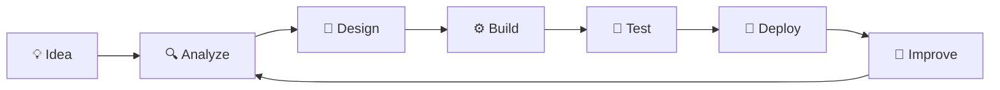

<div align="center">


<a href="https://github.com/muhammadkhalil01">
  
</a>

<br><br>


<br><br>

<a href="https://github.com/muhammadkhalil01"></a>
<a href="mailto:lil4you567@gmail.com"></a>

<br><br>


</div>

<br>

---

<div align="center">

### `LEARN` → `BUILD` → `EXPERIMENT` → `ENGINEER` → `IMPROVE`

</div>

---

## 👨‍💻 About Me

Saya **Muhammad Khalil**, mahasiswa **Information & Computer Technology** di **Politeknik Negeri Lhokseumawe**.
Saya membangun solusi digital yang **praktis, rapi, dan bisa dikembangkan**: dari kode aplikasi, database, API, sampai infrastruktur.

```yaml
name:      Muhammad Khalil
role:      Web & Backend Developer
education: Politeknik Negeri Lhokseumawe (ICT)
location:  Aceh, Indonesia 🇮🇩
focus:     [REST API, Docker, Linux]
learning:  [Cloud, Networking, Cybersecurity]
goal:      Build systems from application code to infrastructure
```

<br>

## 🛠️ Tech Stack

<div align="center">

**Languages & Frameworks**


**Database & Tools**


**DevOps, Systems & IoT**


</div>

<br>

## 🚀 Featured Projects

<table>
<tr>
<td width="33%" valign="top">

### 🌐 Laravel Web App
Autentikasi, CRUD, dan antarmuka responsif.

`Laravel` `PHP` `MySQL` `Bootstrap`

</td>
<td width="33%" valign="top">

### 🐍 Django App
Aplikasi web dengan backend dan database terstruktur.

`Python` `Django` `SQLite`

</td>
<td width="33%" valign="top">

### 🔌 REST API
Integrasi layanan dengan pola request/response.

`Python` `PHP` `JSON`

</td>
</tr>
<tr>
<td width="33%" valign="top">

### 🐳 Docker Lab
Containerization dan environment deployment.

`Docker` `Linux` `Git`

</td>
<td width="33%" valign="top">

### 🤖 Smart IoT
Sensor dan monitoring yang terhubung ke internet.

`ESP32` `Blynk` `Telegram`

</td>
<td width="33%" valign="top">

### 🔐 Security Lab
Network scanning dan dasar keamanan di lab terkontrol.

`Linux` `Nmap` `Networking`

</td>
</tr>
</table>

<br>

## 🏗️ How I Build



<br>

## 🧭 Learning Status

| Area | Teknologi | Status |
|:--|:--|:--:|
| Backend | PHP · Laravel · Python · Django | 🟢 |
| Frontend | HTML · CSS · Bootstrap · JavaScript | 🟢 |
| Database | MySQL · SQLite | 🟢 |
| Version Control | Git · GitHub | 🟢 |
| Integration | REST API · JSON | 🟡 |
| DevOps | Docker · Linux | 🟡 |
| Infrastructure | Networking · Cloud Computing | 🟡 |
| Security | Cybersecurity Fundamentals | 🟡 |

🟢 Aktif &nbsp;•&nbsp; 🟡 Sedang dipelajari

<br>

## 📈 GitHub Analytics

<div align="center">


<br>


<br>


<br>


<br><br>

<!-- Aktif setelah workflow snake.yml dijalankan -->


</div>

<br>

## 🗺️ Roadmap 2026

- [x] Git & GitHub
- [x] Laravel & PHP
- [x] Python & Django
- [ ] Menguasai REST API
- [ ] Docker & DevOps
- [ ] Administrasi Linux
- [ ] Aplikasi berbasis Cloud
- [ ] Kontribusi Open Source
- [ ] Portofolio profesional

<br>

---

<div align="center">

> *"Don't just learn technology. Build something with it."*

**⚡ Building digital systems, one project at a time.**


© 2026 Muhammad Khalil

</div>
